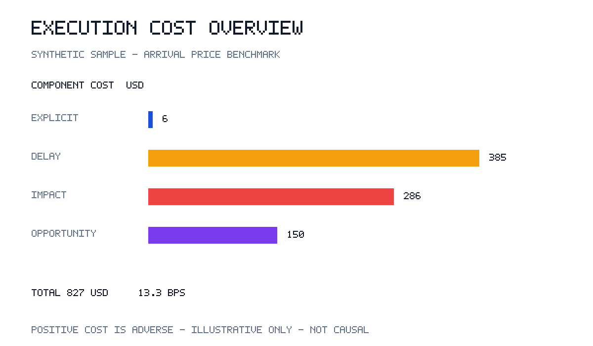
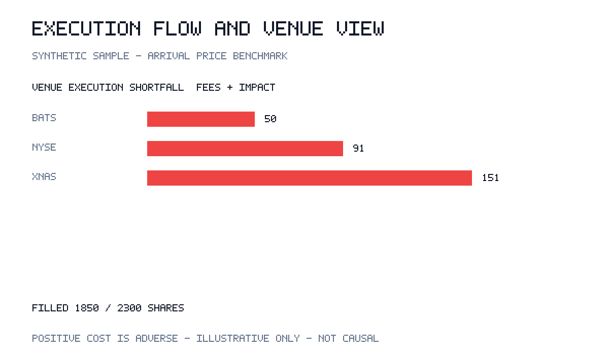

# Transaction Cost Analysis Framework

A dependency-free Python toolkit for auditable arrival-price implementation
shortfall analysis. It validates parent orders and fills, decomposes signed
costs, summarizes results by instrument and execution venue, and provides a
JSON CLI plus generated SVG/PNG report charts.

## Quickstart

Requires Python 3.10 or later. From this project directory:

```bash
PYTHONPATH=src /opt/homebrew/bin/python3 -m transaction_cost_analysis examples/orders.json
PYTHONPATH=src /opt/homebrew/bin/python3 -m transaction_cost_analysis examples/orders.json --format json
PYTHONPATH=src /opt/homebrew/bin/python3 -m transaction_cost_analysis examples/orders.json --write-reports reports
PYTHONPATH=src /opt/homebrew/bin/python3 -m unittest discover -s tests -v
```

If installed with `python -m pip install -e .`, the `tca` command is also
available. The framework and report generation use only the Python standard
library.

## Cost methodology and units

Each order has a decision price, an arrival price, fills, and a terminal
reference price. The arrival-price benchmark is the market reference when the
order is released for execution. The engine uses positive values for adverse
cost and negative values for favorable cost. For side sign \(s=+1\) for buys
and \(s=-1\) for sells:

```text
explicit cost    = sum(fill fees)
delay cost       = s × order quantity × (arrival price − decision price)
market impact    = sum(s × fill quantity × (fill price − arrival price))
opportunity cost = s × unfilled quantity × (terminal price − arrival price)
total shortfall  = explicit + delay + market impact + opportunity
shortfall (bps)  = 10,000 × total shortfall / (order quantity × arrival price)
```

This decomposition reconciles executed slippage and unfilled opportunity
relative to the decision price, plus explicit fees. It assumes one share per
unit and no contract multiplier: quantities are shares, prices are currency
per share, fees and costs are in the declared currency, and bps use total
arrival notional. Do not combine currencies without converting inputs first.
Venue shortfall attributes only fees and arrival-to-fill slippage for filled
shares; order-level delay and unfilled opportunity are not assigned to a
venue. Instrument summaries include all four components.

The included `examples/orders.json` data is synthetic and illustrative, not
historical market data. The market-impact component is an accounting
decomposition of realized execution slippage, **not a causal estimate** of
market impact. This framework does not infer counterfactual prices, optimize
execution, account for taxes/FX/contract multipliers, or replace best
execution and market-risk controls. A terminal price is a user-supplied
markout horizon, not a universal benchmark.

## Input format

```json
{
  "currency": "USD",
  "orders": [
    {
      "order_id": "order-1",
      "instrument": "XYZ",
      "side": "buy",
      "quantity": 100,
      "decision_price": 9.90,
      "arrival_price": 10.00,
      "decision_time": "2026-01-01T10:00:00Z",
      "arrival_time": "2026-01-01T10:01:00Z",
      "end_price": 10.50,
      "end_time": "2026-01-01T10:10:00Z",
      "executions": [
        {
          "venue": "XNAS",
          "quantity": 60,
          "price": 10.02,
          "fee": 1.50,
          "timestamp": "2026-01-01T10:03:00Z"
        }
      ]
    }
  ]
}
```

All timestamps must be timezone-aware ISO-8601. Fill timestamps must fall
between arrival and terminal timestamps. Filled quantity cannot exceed the
parent order size. Orders may be partially filled or entirely unfilled;
omitted fill fees default to zero.

## Example report

The charts below are rendered from `examples/orders.json`. They are white
background screenshots with data-driven cost and venue bars; the paired SVGs
are editable/vector alternatives.





Regenerate the two PNG and SVG files with `--write-reports reports`.

## Python API

```python
from transaction_cost_analysis import Execution, Order, TransactionCostAnalyzer

order = Order(
    order_id="o1", instrument="XYZ", side="buy", quantity=100,
    decision_price=9.9, arrival_price=10.0,
    decision_time="2026-01-01T10:00:00Z",
    arrival_time="2026-01-01T10:01:00Z",
    end_price=10.5, end_time="2026-01-01T10:10:00Z",
    executions=(Execution("XNAS", 60, 10.02, 1.5, "2026-01-01T10:03:00Z"),),
)
report = TransactionCostAnalyzer([order], currency="USD").analyze()
print(report["totals"]["total_shortfall"])
print(report["by_venue"])
```
